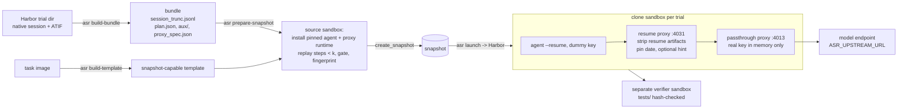

# agent-snapshot-resume

Resume a recorded agent run from step *k* in a sandbox, so the agent continues with the same files and the same
model context it had at step *k*.

You give it a finished Harbor trial (for example a failed one) and a step number *k*. It restores two things, then
lets the agent continue:

1. **Environment.** A sandbox snapshot taken after replaying the side effects of steps 1..k-1 (file writes, shell
   commands, background jobs). Each resumed trial is a clone of that snapshot.
2. **Conversation.** The agent's native session file, cut right before step *k*, resumed with the agent's own
   resume command (`claude --resume <sid> --print` for Claude Code). A small proxy in the sandbox rewrites every
   model request so the model sees the original prefix: the resume-only messages are removed, the original date is
   kept, and you can add one optional hint.

Typical uses: re-run a failure from the step where it went wrong, test whether a hint at step *k* fixes it,
sample several continuations of the same prefix, or collect on-policy continuations for training data.

Claude Code is the only adapter so far. Agent-specific code is in one module (`agents/claude_code.py`); a new agent,
for example Codex, needs one more module of the same shape ([docs/adding-an-agent.md](docs/adding-an-agent.md)).

The sandbox side targets **E2B-compatible services**. It was built and tested on Alibaba Cloud Function Compute
(FC) sandboxes, which support snapshots. Jobs run under [Harbor](https://github.com/laude-institute/harbor)
0.23.0 (pinned).

## Why snapshot + session (and not re-running from the start)

- Re-running from step 1 costs model calls, and the model may diverge before it reaches step *k*.
- Replaying only the conversation leaves the agent in an empty workspace, so files it created earlier are missing.
- Replaying only the workspace and sending a new prompt changes the context: the model sees a different
  conversation.

This tool restores the workspace and the conversation together and checks both. The snapshot is built once per
(trial, k). After that, every clone starts in seconds with the same task files, which is checked by fingerprint.

## How it works



| Stage | Command | Runs where | Model calls | Secrets |
|---|---|---|---|---|
| Bundle | `asr build-bundle` | your machine, offline | none | none |
| Template | `asr build-template` | sandbox service | none | registry creds (optional) |
| Snapshot | `asr prepare-snapshot` | one source sandbox | none | none enter the sandbox |
| Resume | `asr launch` (Harbor) | one clone per trial + verifier | yes (unless `--fake`) | key in proxy memory only |

## Quickstart

Requirements: [uv](https://docs.astral.sh/uv/), an E2B-compatible sandbox account with snapshot support, a Harbor
trial dir with a Claude Code 2.1.207 session, and the Harbor task dir it ran on.

```bash
git clone <this repo> agent-snapshot-resume && cd agent-snapshot-resume
uv sync
cp .env.example .env    # fill in E2B_*, ASR_UPSTREAM_URL, ASR_UPSTREAM_KEY
uv run pytest -q        # offline tests, no sandbox, no model
```

### 0. Try the offline part on the bundled synthetic fixture

```bash
uv run asr build-bundle --trial-dir examples/fixtures/synthetic-trial \
    --task-dir examples/fixtures/sum-task --step 4 --out bundles
uv run asr selfcheck --bundle bundles/synthetic-trial-syntheti-s4-same
# {"equivalent": true, "n_ref_blocks": 6, "n_matched_in_order": 6, ...}
```

`selfcheck` builds the request Claude Code would send on resume (approximately), passes it through the resume
proxy's rewrite function, and checks it against the original prefix. Nothing leaves your machine.

### 1. Build a bundle from a real trial

```bash
uv run asr build-bundle \
    --trial-dir /path/to/jobs/<job>/<trial> \
    --task-dir  /path/to/tasks/<task> \
    --step 27 --out bundles            # 27 = ATIF step_id of the first step to regenerate
# optional: --mode hint --hint-file hint.txt ; --fingerprint-root /app --fingerprint-root /data/out
```

Instead of `--step` you can give `--cut-line L` (0-based session line where the regenerated step starts). Cuts after
one or more context compactions are supported.

Check `bundles/<run_id>/bundle.json`: `cut_line`, `agent_budget_s` (task agent timeout − time elapsed before *k*),
`n_replay_actions`, `resume_cost.bg_inflight` / `subagents_inflight` (pick a *k* where both are 0), `flags`,
`n_compactions_before_cut`, and `orig_request_at_k` (the original run's request at the cut, located in the original
proxy log by token usage; used by the parity gate).

Before paying for a sandbox, screen candidate cuts offline:

```bash
uv run asr screen --trial-dir /path/to/jobs/<job>/<trial> --task-dir /path/to/tasks/<task> \
    --cut-line 372 --cut-line 2251          # one JSON line per cut; --full lists every risk
# {"trial": ..., "cut_line": 372, "verdict": "review", "rules": {"warn:network": 4, "warn:glob_order": 3, ...}}
```

`block` means the replay gate is expected to fail or the restored state is known to differ (a background job or
sub-agent still running at the cut, a read of a running job's output); `review` lists pace-, order- or
network-dependent commands the gate will look at (see [docs/design.md](docs/design.md#screening-cuts-offline-asr-screen)).

### 2. Register a snapshot-capable template for the task image

```bash
uv run asr build-template --task-dir /path/to/tasks/<task>     # writes state/template-<task>.json
```

### 3. Replay steps < k and snapshot

```bash
uv run asr prepare-snapshot --task-dir /path/to/tasks/<task> --bundle bundles/<run_id> \
    --template state/template-<task>.json --tag <task>-s27
# -> state/snapshot-<task>-s27.json with snapshot_id, fingerprint_source, replay_gate_passed=true
```

If the replay gate fails, nothing is snapshotted. Check `state/<tag>-replay_report.json`. Common benign differences
(ls `.`/`..` rows, `time` reports, cProfile timings, timing lines, bash's own error prefix, directory-listing order of
read-only commands, ...) are accepted automatically and named in the report (`automatic_equivalence`). If another
difference is benign (for example a hardware probe prints another memory size), add a reviewed exception bound to
that command's sha256 in `bundle.json` → `replay_reviewed_exceptions` (see
[docs/design.md](docs/design.md#replay-gate)). Then
retry with a new `--tag`, or use `--retain-on-gate-failure` and finish with
`asr prepare-snapshot --continue state/snapshot-<tag>.json`.

### 4. Dry run: prove context equivalence without a model

```bash
uv run asr launch --bundle bundles/<run_id> --task-dir /path/to/tasks/<task> \
    --snapshot-state state/snapshot-<task>-s27.json --fake --no-verifier
uv run asr equiv <trial>/agent/sessions/projects/<slug>/<sid>.jsonl <cut_line> \
    jobs/<job>/<trial>/agent/resume-proxy/<run_id>/first_request_rewritten.json --sentinel <sentinel>
# {"equivalent": true, ...}
```

With `--fake`, the resume proxy answers every request with `end_turn` and logs the raw and rewritten first request.
No key is needed and no model is called.

**Request parity.** When the bundle located the original request at the cut (`orig_request_at_k`), the resume proxy
checks the first rewritten request against it and refuses it and every later request (HTTP 400, nothing sent
upstream) unless, without the hint block and serialised as the original route logged it, it has exactly the
original byte length, the same model, message count, `max_tokens`, `thinking` and tools, the system prompt the agent
persisted, and every message block of the session prefix in order (`first_request_parity.json` in the resume-proxy
log dir). `--parity-gate require` refuses to launch a bundle without the record and, for a real run, also needs
`--freeze-first-request jobs/<fake job>/<trial>/agent/resume-proxy/<run_id>/first_request_rewritten.json`: the real
first request must then be identical (every field but `metadata`) to the fake run's parity-checked one. `off`
disables the gate. Offline:
`asr parity bundles/<run_id> <first_request_rewritten.json> --passthrough-args '...'`.
`--max-model-requests N` stops a continuation after N model requests (useful for cheap real-route probes).

Use `--original-trial-dir <trial>` so the resumed agent gets the same non-secret env and kwargs as the original run.
If the original config used `${VAR}` templates (for example `CLAUDE_CODE_MAX_OUTPUT_TOKENS`), `launch` fills them from
your shell or drops them with a warning. Pass the original value with `--agent-env VAR=value`, otherwise request
parameters such as `max_tokens` differ from the original run. Compare the whole first request, not only `equiv`
(which checks the message prefix).

If the original route started its in-sandbox proxy with extra flags (for example `--drop-fields metadata
--strip-is-error` for a backend that rejects those fields), pass them with
`--passthrough-args '--drop-fields metadata --strip-is-error'` (whitelisted flags only). A `same` and a `hint` bundle
cut at the same step can share one snapshot (see [docs/design.md](docs/design.md#sharing-one-snapshot-between-bundles)).

### 5. Real resume

```bash
uv run asr launch --bundle bundles/<run_id> --task-dir /path/to/tasks/<task> \
    --snapshot-state state/snapshot-<task>-s27.json
# add --dry-run to only write/print runs/<job>/job.json
```

### 6. Clean up

```bash
uv run asr sandboxes                    # lists only sandboxes with metadata owner=$ASR_OWNER_TAG
uv run asr sandboxes --kill-id <sandbox-id>
uv run asr delete-snapshot <snapshot-id>  # snapshots are billed while they exist
```

## Configuration

| Variable | Used by | Meaning |
|---|---|---|
| `E2B_API_KEY`, `E2B_API_URL`, `E2B_DOMAIN` | all sandbox commands | sandbox service credentials and endpoints |
| `ASR_UPSTREAM_URL` | `launch`, agent | Anthropic-messages-compatible base URL the in-sandbox passthrough proxy forwards to; must be reachable from the sandbox; its host is added to the agent's egress allow-list |
| `ASR_UPSTREAM_KEY` | agent (Harbor process) | model key. Read from the Harbor process env, sent into the sandbox only as the env of one exec and then through a pipe; never in the job config, bundle, snapshot, or a file |
| `ASR_MODEL` | `launch` | model name for the resumed agent (default: the original run's) |
| `ASR_OWNER_TAG` | all sandbox commands | sandbox metadata `owner` and template-name prefix (default `asr`); `sandboxes` only lists/kills these |
| `REGISTRY_USERNAME`, `REGISTRY_PASSWORD` | `build-template` | private task image registry |
| `FC_SANDBOX_VPC`, `FC_SANDBOX_CREATE_CONCURRENCY`, `FC_SANDBOX_CREATE_INTERVAL` | `VpcSandboxEnvironment` | FC-only VPC join and creation pacing |

Stable Harbor import paths:

- `agent_snapshot_resume.sandbox.snapshot_env:SnapshotCloneEnvironment`
- `agent_snapshot_resume.agents.claude_code:ClaudeCodeSnapshotResume`
- `agent_snapshot_resume.sandbox.fc_env:SandboxEnvironment` / `:VpcSandboxEnvironment` (plain FC runs, no resume)

## Hints that survive context compaction (`--persist-hint`)

A `--mode hint` bundle injects the hint as a `<system-reminder>` block on the fork turn. The resume proxy finds that
turn by the sentinel prompt; once the agent auto-compacts its context, the sentinel turn is summarised away and the
hint would silently disappear from every later request. Build the bundle with `--persist-hint` to keep it: when a
request has no sentinel but carries a compaction summary (a user message containing "This session is being continued
from a previous conversation"), the proxy appends the same hint block once to the latest such message (moving that
message's cache breakpoint onto it). It never duplicates the hint (if the hint text is already present verbatim it does
nothing) and leaves requests without a summary (e.g. sub-agent requests) untouched. Every `requests.jsonl` record
carries `hint_blocks`, `hint_occurrences`, `hint_chain` (one entry per hint the run carries), `compact_summary` and
system/tools fingerprints, and the first request after each compaction is saved as
`post_compaction_request_<i>.json`, so persistence can be audited per request. In a chained run (`--prior-hint-file`)
*every* hint is re-applied, once each, in injection order.

## Mid-run snapshots (`launch --midrun-snapshot-every`)

A resumed run can be resumed again. `asr launch` snapshots its live clone every 20 minutes (and after each context
compaction) and appends one record per snapshot to `<runs-dir>/<job>/midrun-snapshots.jsonl`:

```json
{"ts": "...", "trial": "task__X", "sandbox_id": "sbx-...", "snapshot_id": "...", "session_line": 240,
 "session_line_before": 240, "session_line_after": 249, "n_compactions": 1,
 "trigger": "compaction", "pause_s": 0.84, "create_s": 6.6}
```

* `session_line` is the session line the *image* contains. `create_snapshot` suspends the guest only briefly
  (~0.84 s measured on FC E2B, ~7 s of host time), so the freeze point is derived from the guest's own ticker: every
  session line is timestamped, and lines written after the pause cannot be in the image.
* `trigger` is `start` (the run began), `periodic`, or `compaction` (the agent compacted its context since the last
  snapshot) — a fork after a compaction must have a snapshot after it.
* The snapshotter only connects, reads and snapshots; it never touches the running agent. `asr snapshot-midrun
  --job <job>` attaches to a job that was launched without it (`--once` for a single pass).
* A snapshot of a live clone restarts that clone's processes when it is used as a base image, so
  `prepare-snapshot` stops them (and fails if any survive) before replaying the tail.

## Chained resumes (round N from round N-1's own session)

`build-bundle` given a *resumed* trial dir produces the next round automatically: it reads the run's own
`agent/resume/proxy_spec.json`, `bundle.json`, `run_start.json` and `first_request_rewritten.json`, and

1. strips the previous resume scaffolding (continue turn, synthetic reply, sentinel prompt, resume attachments) and
   reconnects the `parentUuid` chain across the hole;
2. materialises every hint the run carried at the position the proxy injected it, bound to the tool result it
   followed; after a compaction inside the run the hint goes on the summary message instead (where the proxy
   re-injects it);
3. writes the chain into `proxy_spec.json`: `prior_hints`, `required_hint_blocks`, `hint_anchors`,
   `forbidden_sentinels` — the proxy refuses any request that lost, duplicated, reordered or moved a hint, or that
   still contains a previous sentinel;
4. charges the budget from the parent run (`agent_budget_s` − time since `run_start.json`), not from
   `task timeout − session elapsed`, because a resumed session copies the original prefix's timestamps.

```bash
asr build-bundle --trial-dir jobs/round1/task__X --cut-line 812 --task-dir tasks/<task> \
  --mode hint --hint-file round2/task/hint.2.txt --persist-hint \
  --base-snapshot runs/<job>/midrun-snapshots.jsonl --run-id task-s812-h2
```

`--base-snapshot` (a record file; its last line is used) makes `prepare-snapshot` start from that mid-run snapshot
and replay only the actions observed after its `session_line` instead of the whole prefix — those actions' effects
are already in the image. `--full-replay` ignores it. `--prior-hint-file` (repeatable, oldest first) is optional: it
is verified against the run's own spec and only needed to prove the chain from files on disk.

## What "equivalent" means

`asr equiv` compares the rewritten first request with the original session prefix (`lines[:cut]`). The rule:
every content block the original model saw must appear in the request **in the same order and byte-identical**.
That covers instruction text, assistant text, thinking text with its signature, tool_use id/name/input, and
tool_result id/is_error/content. Anything else in the request is reported as an "extra" and classified:

- allowed: the date reminder (pinned to the original date), system messages that Claude Code renders from
  attachments persisted in the prefix (agent/skill listings, task reminders; at most one per prefix attachment),
  and exactly one hint block in `--mode hint`;
- not allowed: the `Continue from where you left off.` block, the synthetic `No response requested.` assistant
  message, the sentinel prompt, or any prefix block that is missing or changed.

**Not covered by this check, and possibly different from the original run:**

- the system prompt's environment lines (kernel version, `Shell:`), because the sandbox is a different machine;
- the provider/route behind `ASR_UPSTREAM_URL`, which may differ from the original run's;
- sampling. Continuations differ by design, so "equivalent" applies only to the input context.

## Known gaps

- **Shell cwd is not restored.** Claude Code restarts its Bash tool in the project root. If the original agent had
  `cd`'d elsewhere (e.g. `/app/work`), the first resumed command may fail on a relative path. Models usually recover
  on the next call. Mitigation: choose a *k* where the cwd equals the project root.
- **Hidden state is not reproduced.** Processes still running at *k*, files written by un-logged processes, random
  seeds, and caches outside the fingerprinted roots are not restored. Background jobs that finished before *k* are
  re-run in the foreground (their outputs are hash-checked). Jobs still running at *k* are started detached and
  flagged. Prefer a *k* with `bg_inflight == 0` and `subagents_inflight == 0`.
- **Replay can diverge.** A replayed command that gives different output fails the gate. Nothing is snapshotted
  until the difference is reviewed.
- **Redacted sessions.** If a pipeline replaced values with `[REDACTED]` in the session, the prefix is no longer
  byte-faithful (flag `redaction_*`). Do not resume such trials.
- **Agent version is pinned.** Claude Code 2.1.207 and 2.1.280 (binary sha256 pinned per version; the bundle uses
  the original run's version). A different version changes the tool list or system prompt, so the context is no
  longer the same.
- **Chained resumes inherit what the previous run left.** A mid-run snapshot contains that run's filesystem plus its
  live processes; the tail is replayed after stopping them. Two chained limits are deliberate and fail closed:
  a hint the proxy had to inject as a *new* message (never a block appended to a tool-result turn) cannot be seeded,
  and a bundle may only chain from a trial that recorded its own `agent/resume/proxy_spec.json` +
  `first_request_rewritten.json`. Large tool outputs the parent run persisted (`tool-results/`) are copied from the
  chained run's own session directory only, so a fork that depends on an earlier round's persisted output fails the
  parity gate instead of silently reading a truncated result.
- **Snapshots need a provider that supports them.** Tested on Alibaba Cloud FC sandbox. `build-template` uses FC's
  `micro` build mode headers.
- The live sandbox path (template build, source preparation, clone, real model) is not exercised by the offline
  tests. `tests/test_recovery_live.py` is a small opt-in live test (`ASR_LIVE_TESTS=1`).

## Adding an agent

Write `src/agent_snapshot_resume/agents/<agent>.py` with:

1. an `AgentAdapter` subclass that finds and parses the native session into the trajectory IR, chooses the cut line,
   collects aux files, installs the pinned version with a sha256 check, and declares the texts the agent injects on
   resume;
2. a Harbor agent class (`SnapshotResumeAgentMixin` + Harbor's installed agent for that CLI) whose `install()` only
   verifies the version and starts the proxies, and whose `run()` seeds the session and runs the agent's resume
   command against `http://127.0.0.1:4031/r/<run_id>` with a dummy key.

Register it in `agents/__init__.py`. The full checklist is in [docs/adding-an-agent.md](docs/adding-an-agent.md).

## Repository layout

```
src/agent_snapshot_resume/
  cli.py                 asr command
  bundle.py              trial dir + k -> bundle
  launch.py              Harbor job config (+ run)
  equiv.py               context-equivalence checker
  config.py              env-var configuration
  trace/                 trajectory IR (ir.py, agent-agnostic) + per-agent parsers (claude_code.py)
  agents/                adapter interface (base.py) + Claude Code adapter
  sandbox/               FC env, snapshot clone env, command recovery, templates, source prep, management
  replay/                stdlib-only in-sandbox replayer, replay gate, fingerprint
  proxy/                 resume rewrite proxy, key passthrough proxy, runtime install/start snippets
docs/                    design.md, adding-an-agent.md, README.zh-CN.md
examples/                job config shape, synthetic fixture trial + task
tests/                   offline tests (+ one opt-in live test)
```

## License

MIT, see [LICENSE](LICENSE).
