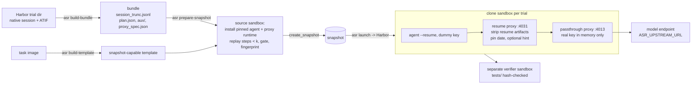

# agent-snapshot-resume

Resume a recorded agent run from step *k* in a sandbox, so the agent continues with the same files and the same
model context it had at step *k*.

You give it a finished Harbor trial (for example a failed one) and a step number *k*. It restores two things, then
lets the agent continue:

1. **Environment.** A sandbox snapshot taken after replaying the side effects of steps 1..k-1 (file writes, shell
   commands, background jobs). Each resumed trial is a clone of that snapshot.
2. **Conversation.** The agent's native session file, cut right before step *k*, resumed with the agent's own
   resume command (`claude --resume <sid> --print` for Claude Code). A small proxy in the sandbox rewrites every
   model request so the model sees the original prefix: the resume-only messages are removed, the original date is
   kept, and you can add one optional hint.

Typical uses: re-run a failure from the step where it went wrong, test whether a hint at step *k* fixes it,
sample several continuations of the same prefix, or collect on-policy continuations for training data.

Claude Code is the only adapter so far. Agent-specific code is in one module (`agents/claude_code.py`); a new agent,
for example Codex, needs one more module of the same shape ([docs/adding-an-agent.md](docs/adding-an-agent.md)).

The sandbox side targets **E2B-compatible services**. It was built and tested on Alibaba Cloud Function Compute
(FC) sandboxes, which support snapshots. Jobs run under [Harbor](https://github.com/laude-institute/harbor)
0.23.0 (pinned).

## Why snapshot + session (and not re-running from the start)

- Re-running from step 1 costs model calls, and the model may diverge before it reaches step *k*.
- Replaying only the conversation leaves the agent in an empty workspace, so files it created earlier are missing.
- Replaying only the workspace and sending a new prompt changes the context: the model sees a different
  conversation.

This tool restores the workspace and the conversation together and checks both. The snapshot is built once per
(trial, k). After that, every clone starts in seconds with the same task files, which is checked by fingerprint.

## How it works



| Stage | Command | Runs where | Model calls | Secrets |
|---|---|---|---|---|
| Bundle | `asr build-bundle` | your machine, offline | none | none |
| Template | `asr build-template` | sandbox service | none | registry creds (optional) |
| Snapshot | `asr prepare-snapshot` | one source sandbox | none | none enter the sandbox |
| Resume | `asr launch` (Harbor) | one clone per trial + verifier | yes (unless `--fake`) | key in proxy memory only |

## Quickstart

Requirements: [uv](https://docs.astral.sh/uv/), an E2B-compatible sandbox account with snapshot support, a Harbor
trial dir with a Claude Code 2.1.207 session, and the Harbor task dir it ran on.

```bash
git clone <this repo> agent-snapshot-resume && cd agent-snapshot-resume
uv sync
cp .env.example .env    # fill in E2B_*, ASR_UPSTREAM_URL, ASR_UPSTREAM_KEY
uv run pytest -q        # offline tests, no sandbox, no model
```

### 0. Try the offline part on the bundled synthetic fixture

```bash
uv run asr build-bundle --trial-dir examples/fixtures/synthetic-trial \
    --task-dir examples/fixtures/sum-task --step 4 --out bundles
uv run asr selfcheck --bundle bundles/synthetic-trial-syntheti-s4-same
# {"equivalent": true, "n_ref_blocks": 6, "n_matched_in_order": 6, ...}
```

`selfcheck` builds the request Claude Code would send on resume (approximately), passes it through the resume
proxy's rewrite function, and checks it against the original prefix. Nothing leaves your machine.

### 1. Build a bundle from a real trial

```bash
uv run asr build-bundle \
    --trial-dir /path/to/jobs/<job>/<trial> \
    --task-dir  /path/to/tasks/<task> \
    --step 27 --out bundles            # 27 = ATIF step_id of the first step to regenerate
# optional: --mode hint --hint-file hint.txt ; --fingerprint-root /app --fingerprint-root /data/out
```

Check `bundles/<run_id>/bundle.json`: `cut_line`, `agent_budget_s` (task agent timeout − time elapsed before *k*),
`n_replay_actions`, `resume_cost.bg_inflight` / `subagents_inflight` (pick a *k* where both are 0), and `flags`.

### 2. Register a snapshot-capable template for the task image

```bash
uv run asr build-template --task-dir /path/to/tasks/<task>     # writes state/template-<task>.json
```

### 3. Replay steps < k and snapshot

```bash
uv run asr prepare-snapshot --task-dir /path/to/tasks/<task> --bundle bundles/<run_id> \
    --template state/template-<task>.json --tag <task>-s27
# -> state/snapshot-<task>-s27.json with snapshot_id, fingerprint_source, replay_gate_passed=true
```

If the replay gate fails, nothing is snapshotted. Check `state/<tag>-replay_report.json`. If a difference is
benign (for example a hardware probe prints another memory size), add a reviewed exception bound to that command's
sha256 in `bundle.json` → `replay_reviewed_exceptions` (see [docs/design.md](docs/design.md#replay-gate)). Then
retry with a new `--tag`, or use `--retain-on-gate-failure` and finish with
`asr prepare-snapshot --continue state/snapshot-<tag>.json`.

### 4. Dry run: prove context equivalence without a model

```bash
uv run asr launch --bundle bundles/<run_id> --task-dir /path/to/tasks/<task> \
    --snapshot-state state/snapshot-<task>-s27.json --fake --no-verifier
uv run asr equiv <trial>/agent/sessions/projects/<slug>/<sid>.jsonl <cut_line> \
    jobs/<job>/<trial>/agent/resume-proxy/<run_id>/first_request_rewritten.json --sentinel <sentinel>
# {"equivalent": true, ...}
```

With `--fake`, the resume proxy answers every request with `end_turn` and logs the raw and rewritten first request.
No key is needed and no model is called.

### 5. Real resume

```bash
uv run asr launch --bundle bundles/<run_id> --task-dir /path/to/tasks/<task> \
    --snapshot-state state/snapshot-<task>-s27.json
# add --dry-run to only write/print runs/<job>/job.json
```

### 6. Clean up

```bash
uv run asr sandboxes                    # lists only sandboxes with metadata owner=$ASR_OWNER_TAG
uv run asr sandboxes --kill-id <sandbox-id>
uv run asr delete-snapshot <snapshot-id>  # snapshots are billed while they exist
```

## Configuration

| Variable | Used by | Meaning |
|---|---|---|
| `E2B_API_KEY`, `E2B_API_URL`, `E2B_DOMAIN` | all sandbox commands | sandbox service credentials and endpoints |
| `ASR_UPSTREAM_URL` | `launch`, agent | Anthropic-messages-compatible base URL the in-sandbox passthrough proxy forwards to; must be reachable from the sandbox; its host is added to the agent's egress allow-list |
| `ASR_UPSTREAM_KEY` | agent (Harbor process) | model key. Read from the Harbor process env, sent into the sandbox only as the env of one exec and then through a pipe; never in the job config, bundle, snapshot, or a file |
| `ASR_MODEL` | `launch` | model name for the resumed agent (default: the original run's) |
| `ASR_OWNER_TAG` | all sandbox commands | sandbox metadata `owner` and template-name prefix (default `asr`); `sandboxes` only lists/kills these |
| `REGISTRY_USERNAME`, `REGISTRY_PASSWORD` | `build-template` | private task image registry |
| `FC_SANDBOX_VPC`, `FC_SANDBOX_CREATE_CONCURRENCY`, `FC_SANDBOX_CREATE_INTERVAL` | `VpcSandboxEnvironment` | FC-only VPC join and creation pacing |

Stable Harbor import paths:

- `agent_snapshot_resume.sandbox.snapshot_env:SnapshotCloneEnvironment`
- `agent_snapshot_resume.agents.claude_code:ClaudeCodeSnapshotResume`
- `agent_snapshot_resume.sandbox.fc_env:SandboxEnvironment` / `:VpcSandboxEnvironment` (plain FC runs, no resume)

## What "equivalent" means

`asr equiv` compares the rewritten first request with the original session prefix (`lines[:cut]`). The rule:
every content block the original model saw must appear in the request **in the same order and byte-identical**.
That covers instruction text, assistant text, thinking text with its signature, tool_use id/name/input, and
tool_result id/is_error/content. Anything else in the request is reported as an "extra" and classified:

- allowed: the date reminder (pinned to the original date), system messages that Claude Code renders from
  attachments persisted in the prefix (agent/skill listings, task reminders; at most one per prefix attachment),
  and exactly one hint block in `--mode hint`;
- not allowed: the `Continue from where you left off.` block, the synthetic `No response requested.` assistant
  message, the sentinel prompt, or any prefix block that is missing or changed.

**Not covered by this check, and possibly different from the original run:**

- the system prompt's environment lines (kernel version, `Shell:`), because the sandbox is a different machine;
- the provider/route behind `ASR_UPSTREAM_URL`, which may differ from the original run's;
- sampling. Continuations differ by design, so "equivalent" applies only to the input context.

## Known gaps

- **Shell cwd is not restored.** Claude Code restarts its Bash tool in the project root. If the original agent had
  `cd`'d elsewhere (e.g. `/app/work`), the first resumed command may fail on a relative path. Models usually recover
  on the next call. Mitigation: choose a *k* where the cwd equals the project root.
- **Hidden state is not reproduced.** Processes still running at *k*, files written by un-logged processes, random
  seeds, and caches outside the fingerprinted roots are not restored. Background jobs that finished before *k* are
  re-run in the foreground (their outputs are hash-checked). Jobs still running at *k* are started detached and
  flagged. Prefer a *k* with `bg_inflight == 0` and `subagents_inflight == 0`.
- **Replay can diverge.** A replayed command that gives different output fails the gate. Nothing is snapshotted
  until the difference is reviewed.
- **Redacted sessions.** If a pipeline replaced values with `[REDACTED]` in the session, the prefix is no longer
  byte-faithful (flag `redaction_*`). Do not resume such trials.
- **Agent version is pinned.** Claude Code 2.1.207 only (binary sha256 pinned). A different version changes the
  tool list or system prompt, so the context is no longer the same.
- **Snapshots need a provider that supports them.** Tested on Alibaba Cloud FC sandbox. `build-template` uses FC's
  `micro` build mode headers.
- The live sandbox path (template build, source preparation, clone, real model) is not exercised by the offline
  tests. `tests/test_recovery_live.py` is a small opt-in live test (`ASR_LIVE_TESTS=1`).

## Adding an agent

Write `src/agent_snapshot_resume/agents/<agent>.py` with:

1. an `AgentAdapter` subclass that finds and parses the native session into the trajectory IR, chooses the cut line,
   collects aux files, installs the pinned version with a sha256 check, and declares the texts the agent injects on
   resume;
2. a Harbor agent class (`SnapshotResumeAgentMixin` + Harbor's installed agent for that CLI) whose `install()` only
   verifies the version and starts the proxies, and whose `run()` seeds the session and runs the agent's resume
   command against `http://127.0.0.1:4031/r/<run_id>` with a dummy key.

Register it in `agents/__init__.py`. The full checklist is in [docs/adding-an-agent.md](docs/adding-an-agent.md).

## Repository layout

```
src/agent_snapshot_resume/
  cli.py                 asr command
  bundle.py              trial dir + k -> bundle
  launch.py              Harbor job config (+ run)
  equiv.py               context-equivalence checker
  config.py              env-var configuration
  trace/                 trajectory IR (ir.py, agent-agnostic) + per-agent parsers (claude_code.py)
  agents/                adapter interface (base.py) + Claude Code adapter
  sandbox/               FC env, snapshot clone env, command recovery, templates, source prep, management
  replay/                stdlib-only in-sandbox replayer, replay gate, fingerprint
  proxy/                 resume rewrite proxy, key passthrough proxy, runtime install/start snippets
docs/                    design.md, adding-an-agent.md, README.zh-CN.md
examples/                job config shape, synthetic fixture trial + task
tests/                   offline tests (+ one opt-in live test)
```

## License

MIT, see [LICENSE](LICENSE).
